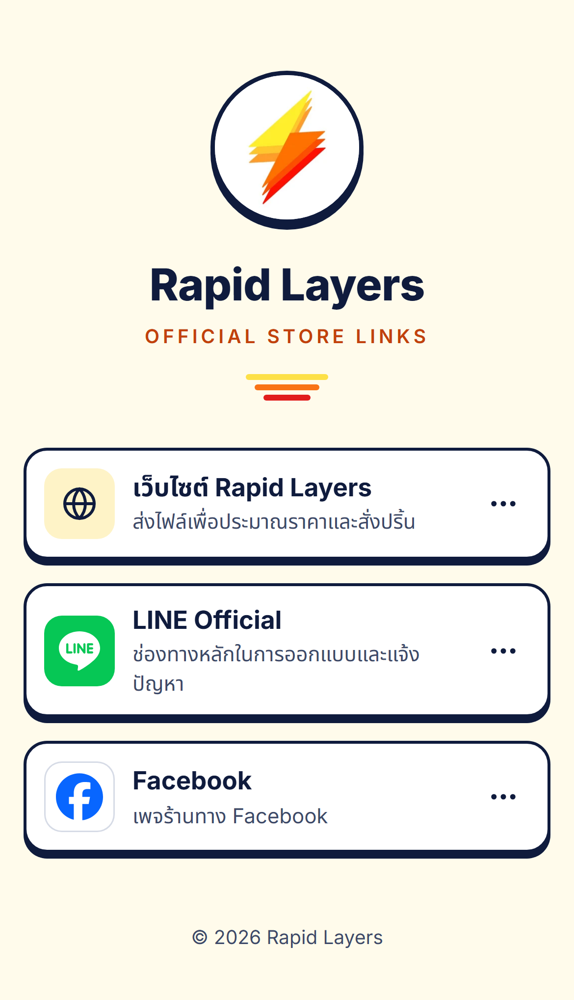

# รายงานส่งมอบงาน — Rapid Layers Store Links

วันที่ส่งมอบ: 20 ตุลาคม 2026

- **เว็บจริง:** https://b1zyyy.github.io/rapid-layers-links/
- **Repository:** https://github.com/B1zyyy/rapid-layers-links

**สถานะ:** ใช้งานได้จริงบน production ยังขาด Definition of Done 1 ข้อ คือตอนนี้แสดง **3 การ์ด** ไม่ใช่ 4 เพราะช่องที่ 4 ยังไม่มีข้อมูล ผมจึงซ่อนไว้ (`enabled: false`) แทนการแสดง placeholder

---

## 1. สิ่งที่สร้าง

- หน้าเว็บมีโลโก้สายฟ้าในวงกลม ชื่อ Rapid Layers และการ์ด 3 ช่องทาง: เว็บไซต์, LINE Official, Facebook
- **เมนู ⋯ บนการ์ด**
  - Share: ใช้ Web Share API
  - Copy: ใช้ Clipboard API แล้วใช้วิธีเก่าเป็นทางสำรอง ถ้ายังไม่ได้ จะเลือกลิงก์ไว้ให้คัดลอกเอง
  - ข้อความ "สำเร็จ" ขึ้นเฉพาะเมื่อสำเร็จจริง
- **สี** ใช้สัดส่วน 60/30/10:
  - ครีมเหลืองและขาว เป็นพื้นหลัง
  - น้ำเงินเข้ม `#0F1B3D` เป็นข้อความและเส้นขอบ
  - ส้ม `#F97316` เป็นสีเน้น
  - ใต้การ์ดมี "ชั้น" สีน้ำเงิน และเปลี่ยนเป็นส้มเมื่อเอาเมาส์ชี้ ล้อกับชื่อ Layers
- ข้อมูลร้านค้าอยู่ที่จุดเดียว ระบบตรวจทุกครั้งก่อน build รองรับไฟล์ PDF และเพิ่มได้สูงสุด 10 ช่อง
- คู่มือภาษาไทย [`STORE_MANAGEMENT.md`](../STORE_MANAGEMENT.md)

## 2. หลักฐาน UI

| หน้าจอ | ไฟล์ |
|---|---|
| เว็บจริง (iPhone) | [screenshots/prod-iphone.png](screenshots/prod-iphone.png) |
| เมนูแชร์บนมือถือ | [screenshots/iphone-390-menu.png](screenshots/iphone-390-menu.png) |
| จอเล็ก 320px | [screenshots/phone-320.png](screenshots/phone-320.png) · [เมนู](screenshots/phone-320-menu.png) |
| แท็บเล็ต 768px | [screenshots/tablet-768.png](screenshots/tablet-768.png) · [เมนู](screenshots/tablet-768-menu.png) |
| เดสก์ท็อป 1280px | [screenshots/desktop-1280.png](screenshots/desktop-1280.png) · [เมนู](screenshots/desktop-1280-menu.png) |
| สาธิต 10 ช่อง (ข้อมูลทดลอง ไม่ได้เผยแพร่) | [screenshots/demo-10-cards.png](screenshots/demo-10-cards.png) |

ภาพหน้าปลายทางที่บันทึกตอนตรวจลิงก์อยู่ใน `docs/verification/` เก็บไว้ในเครื่องเท่านั้น ไม่อัปขึ้น GitHub เพราะ repo เป็นสาธารณะ

## 3. Technology stack

Astro 7 (static), TypeScript, Zod, Fontsource (Inter + Noto Sans Thai), Vitest, Playwright, GitHub Actions และ GitHub Pages
ดูรายละเอียดใน [README.md](../README.md)

## 4–5. ไฟล์สำคัญ และจุดที่ใช้แก้ข้อมูล

| ต้องการแก้ | ไฟล์ |
|---|---|
| ชื่อแพลตฟอร์ม, URL, คำอธิบาย, ไอคอน, ลำดับ, เปิด/ปิด | `src/data/stores.json` |
| ชื่อแบรนด์, title, meta description, ข้อความบนเมนู | `src/data/site.json` |
| ไฟล์ PDF ที่ลิงก์จากการ์ด | `public/files/` |
| ไอคอนแพลตฟอร์มใหม่ | `src/lib/icons.ts` + `src/components/PlatformIcon.astro` |
| โลโก้แบรนด์ | `brand/rapid-layers-logo-original.jpg` แล้วรัน `npm run brand:assets` |
| URL เว็บหรือโดเมน | `deploy.config.mjs` |

## 6. การเพิ่มแพลตฟอร์ม (สูงสุด 10 ช่อง)

เพิ่มรายการใน `stores.json` ไม่ต้องเขียนโค้ดใหม่ ขั้นตอนอยู่ใน [STORE_MANAGEMENT.md](../STORE_MANAGEMENT.md)

ผมสาธิตแล้วทุกกรณีต่อไปนี้:

| กรณี | ผล |
|---|---|
| เพิ่มการ์ด PDF แต่ยังไม่วางไฟล์ / ชื่อไฟล์ผิดตัวพิมพ์ใหญ่-เล็ก | ❌ แจ้ง error ตามที่ตั้งใจ |
| เพิ่มการ์ด PDF แบบถูกต้อง | ✅ ผ่าน |
| เปิด 10 ช่อง | ✅ แสดงผลครบและผ่าน e2e |
| เปิด 11 ช่อง | ❌ build ไม่ผ่าน ตามที่ตั้งใจ |
| เปลี่ยน Facebook เป็น Instagram (แก้รายการเดียว) | ✅ |
| ปิด LINE ชั่วคราว | ✅ หายจากหน้าเว็บ |
| ลบ Facebook | ✅ |
| สลับลำดับให้ LINE ขึ้นก่อน | ✅ |
| ข้อมูลผิดหลายจุดพร้อมกัน | ระบบแจ้งครบทุกจุดเป็นภาษาไทย |
| JSON ผิดรูปแบบ (`,` เกิน) | ระบบบอกเลขบรรทัดที่ผิด |

## 7. Environment variables และ Secret

เว็บนี้ไม่ใช้ secret เลย ชื่อร้านและ URL เป็นข้อมูลสาธารณะ จึงเก็บไว้ใน `src/data/`

- `.env.example` มีแต่คำอธิบาย ไม่มีค่าจริง
- `.gitignore` กันไฟล์ `.env*` ไม่ให้ขึ้น repo
- `npm run scan:secrets` สแกนทั้ง source และ `dist/` ทุกครั้งใน CI ทดสอบแล้วว่าจับ key ปลอมที่ใส่ไว้ได้จริง
- ถ้าอนาคตต้องใช้ secret ต้องใช้ server-side function ห้ามใส่ในโค้ดหน้าเว็บ

## 8. ผลทดสอบที่รันจริง

| รายการ | ผล |
|---|---|
| `npm ci` + `npm audit` | ✅ 0 vulnerabilities |
| Type check (`astro check`) | ✅ 0 errors |
| Unit tests (Vitest) | ✅ 56/56 |
| Production build | ✅ รวม 408 KB, HTML 4.4 KB (gzip) |
| Secret scan | ✅ ไม่พบ |
| E2E ในเครื่อง (5 ขนาดจอ) | ✅ ผ่าน 89, ข้าม 6 |
| E2E บน GitHub Actions | ✅ ผ่าน 89 |
| E2E บนเว็บจริง (`npm run test:prod`) | ✅ ผ่าน 89 |

- **ข้าม 6:** เป็นเทสต์คีย์บอร์ดที่ตั้งใจไม่รันบนขนาดจอมือถือ
- **รอบแรกที่ทดสอบเว็บจริง:** มีเทสต์ timeout 2 ข้อ เพราะรันพร้อมกันมากเกินไปผ่านเครือข่าย พอลดจำนวน worker ก็ผ่านครบ เว็บโหลดจริงใช้ 0.24–0.65 วินาที

**ข้อจำกัด**
- E2E ใช้ Chromium จำลองขนาดจอต่าง ๆ ยังไม่ได้ทดสอบบน Safari หรือ iPhone จริง และยังไม่ได้ทดสอบใน in-app browser ของ LINE/Facebook บนมือถือจริง
- เมนู Share ทดสอบด้วย Web Share API จำลอง

## 9. ผลตรวจลิงก์ปลายทาง

ทดสอบโดยกดการ์ดบนเว็บจริงด้วย Chromium แล้วดูว่าไปถึงหน้าไหน

| ช่องทาง | ผล | หลักฐาน |
|---|---|---|
| เว็บไซต์ | ✅ PASS | ไปถึง `rapid-layers.com/th/contact` ชื่อหน้า "ติดต่อเรา \| RapidLayers" |
| LINE | ✅ PASS | `lin.ee/PcYmKD6` redirect 301 ไปที่ `line.me/R/ti/p/@935rsequ` ซึ่งตรงกับปุ่ม LINE บนเว็บ rapid-layers.com หน้า LINE เองไม่แสดงชื่อบัญชี จึงยืนยันด้วยการเทียบกับเว็บ |
| Facebook | ✅ PASS | ชื่อหน้า "Rapid Layers \| Bangkok" และคำอธิบายตรงกับธุรกิจรับปริ้น 3D |

## 10–11. Production, Domain, HTTPS และ Hosting

- **Hosting:** GitHub Pages (repo สาธารณะ) ออนไลน์ต่อเนื่องโดยไม่ต้องเปิดคอมพิวเตอร์ทิ้งไว้
- **HTTPS:** ✅ ใช้งานได้ HTTP redirect ไป HTTPS (301) และเปิด HSTS
- **Deploy:** push ขึ้น `main` แล้วระบบจะทดสอบทุกขั้นก่อน deploy ถ้าไม่ผ่าน เว็บจริงจะเป็นเวอร์ชันเดิม
- **Domain:** ยังไม่มีโดเมนเฉพาะ ถ้าต้องการ เช่น `links.rapid-layers.com` ดูขั้นตอนใน README โดยต้องเพิ่ม CNAME ใน Cloudflare เอง

## 12. ค่าใช้จ่าย ข้อจำกัด และสิ่งที่ต้องทำต่อ

**ค่าใช้จ่าย:** ฟรี เว็บจะออนไลน์ตราบที่บัญชี GitHub ยังใช้งานได้ และไม่มีระบบใดรับประกัน uptime 100%

**สิ่งที่ต้องทำต่อ**
1. ส่งข้อมูลช่องที่ 4 มาเมื่อพร้อม จะเป็น PDF หรือลิงก์ก็ได้ เพื่อให้ครบ 4 ช่องตามเป้าหมาย
2. ทดสอบบนมือถือจริง ทั้ง iPhone และ Android และใน LINE/Facebook รวมถึงปุ่ม Share/Copy
3. ถ้าต้องการเปลี่ยนข้อความเมนูเป็นภาษาไทย หรือเปลี่ยนชื่อการ์ด แก้ได้ที่ `src/data/site.json` และ `src/data/stores.json`

## Definition of Done

- [x] แบรนด์ Rapid Layers ชัดเจน
- [x] ใช้โทนสีตาม brand direction
- [ ] แสดง Store Card 4 ช่อง: **ตอนนี้ 3 ช่อง รอข้อมูลช่องที่ 4**
- [x] แต่ละช่องมีโลโก้และชื่อแพลตฟอร์มถูกต้อง
- [x] ลิงก์ที่เปิดอยู่ทั้งหมดไปถึงหน้าร้านจริงที่ยืนยันแล้ว (3/3)
- [x] เมนู ⋯ มี Share และ Copy ที่ทำงานจริง
- [x] Responsive และ accessible ตามข้อกำหนดที่ทดสอบได้
- [x] โครงสร้างรองรับสูงสุด 10 ช่อง
- [x] ไม่มี secret ใน source และ public bundle
- [x] Tests และ production build ผ่าน
- [x] เผยแพร่และตรวจบน production จริงแล้ว
- [x] ไม่มี placeholder ที่แสดงเป็นข้อมูลจริง
- [x] มีคู่มือแก้ไขข้อมูลร้านค้า (`STORE_MANAGEMENT.md`)
- [x] เพิ่ม เปลี่ยน ปิด และลบช่องทางได้จากแหล่งข้อมูลกลางจุดเดียว
- [x] ทดสอบการอัปเดตข้อมูลและ production build แล้ว
- [x] รายงานข้อจำกัดอย่างโปร่งใส (ดูข้อ 8 และ 12)
